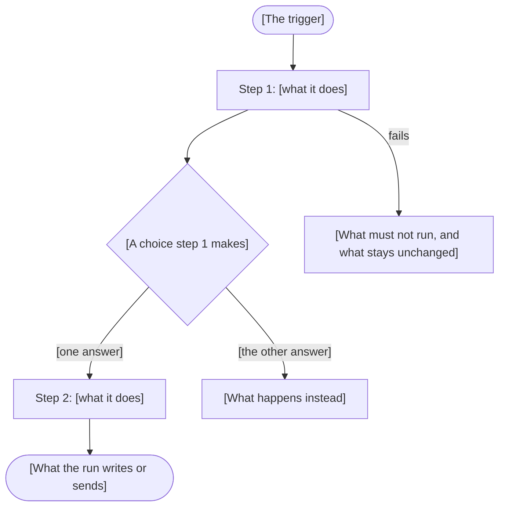

# DAG contracts

A DAG contract states what one DAG must do. Engineers and agents build the DAG from it, and reviewers check every change against it. A person and an agent write one the same way.

## Contents

1. Write a contract
2. The default DAG configuration
3. The contract skeleton
4. Behavior steps
5. Diagrams
6. Check the draft

## 1. Write a contract

1. Find the contract: the file in `docs/` whose first heading names the `dag_id` in backticks. For a new DAG, copy the skeleton in section 3 into `docs/<dag-id>.md`, with hyphens in place of underscores.
2. Ask the DAG's owner the questions below.
3. Fill the four sections from the answers, in their order.
4. Draw the diagrams at the end of the behavior section.
5. Check the draft against section 6.
6. Ask the owner to confirm the contract. An agent stops here and waits for the answer.

To change a contract, change the smallest part that carries the new behavior. When you add, remove, or reorder a step, fix every "After step N" that points at the old numbers, and redraw the diagrams in the same change.

### Ask the owner

The contract records business decisions, and only the DAG's owner can make them.

- When an answer is missing, stop and ask. Do not guess, and do not take the answer from existing code. **Why**: the code may be the part that is wrong.
- Mark an open question in the draft as `[Open: the question]`. A draft with an open question is not ready to confirm.

| Section | Ask |
|---|---|
| Opening | What does the DAG do, and who uses its result? What must it never change? |
| DAG configuration | What is the DAG ID? Does it run on a schedule, or only when a person triggers it? Which regions run it? |
| Inputs | What does the DAG read? What does a person submit to start a run? Which inputs must stop the run? |
| Behavior | What happens, in order? Which work repeats, and once for each of what? Which work can run at the same time? What are the limits, as numbers? What does a step leave alone? What is the reason for each choice? Where must a person approve? |
| Results and failures | What does a run write or send? When a step fails, what must not run, and what must stay unchanged? What does a rerun do with finished work? What should a person check after the run? |

For the DAG configuration, ask only those three questions. Every other setting has a default. When the owner says nothing about a setting, leave it out of the contract.

### Writing rules

- Describe the outcome the DAG must reach. Leave task names, function names, and file layout to whoever builds it.
- Give every limit as a number, such as "at most three at the same time".
- State each rule once. When another contract owns a rule, link to it.
- Put the reason for a rule beside the rule.

## 2. The default DAG configuration

Every DAG starts with these settings. Keep this table in `docs/dag-contract-template.md`, with your own regions' values.

| Setting | Default |
|---|---|
| Deployment | One self-contained DAG file for each region. Every regional file uses the same DAG ID. |
| Timezone | The region's business timezone, one per region. |
| Start date | A fixed date in the regional timezone, such as the first day of the current year. |
| Catchup | Off. The DAG does not run for dates in the past. |
| Concurrent runs | One active run in each regional Airflow instance. |
| Run timeout | 1 hour. |
| Task retries | One retry, five minutes after the failure. |
| Worker queue | The region's default queue. |
| Pool | The default pool. Name any folder whose DAGs use a separate pool, such as long maintenance jobs. |
| Owner | The team name, such as `data engineer`. |

Three settings have no default, so every contract states them:

| Setting | What the contract states |
|---|---|
| DAG ID | The exact DAG ID. |
| Trigger | The schedule, such as "Daily at 09:00 in the regional timezone", or "Manual only". |
| Regions | The regions that run the DAG. |

## 3. The contract skeleton

````markdown
# [DAG name] (`dag_id`)

[Say in one or two sentences what the DAG does and who uses its result. Then say what the DAG must never change.]

## DAG configuration

This DAG uses the [default DAG configuration](dag-contract-template.md#default-dag-configuration), with the values below.

| Setting | Value |
|---|---|
| DAG ID | [The exact DAG ID.] |
| Trigger | [The schedule, or "Manual only".] |
| Regions | [The regions that run this DAG.] |
| [A setting the owner asked for] | [The owner's value, and why.] |

## Inputs

- [Each external API, with its address.]
- [Each Airflow Variable and each connection, by name.]
- [Each value a person submits when they trigger a run, with a small example when the shape matters.]

[Then list the inputs that stop the run, and say that the run stops before it changes anything.]

## Behavior

1. [What the first step does, in one sentence.]
   - **Why**: [The business rule behind a choice in this step.]
   - Limit: [The most this step may do, as a number.]
   - If this fails: [The steps that must not run, and the state that must stay unchanged.]

2. [What the next step does, and which steps it waits for.]

[State every point where a person must review, approve, or confirm before the run continues.]

### Diagrams

The numbered steps are the rule. These diagrams draw them, and where a diagram and a step disagree, the step wins.



## Results and failures

- [What a successful run writes or sends, and where.]
- [The state that stays unchanged when a step fails.]
- [What a retry or a rerun does with work that already finished.]
- [What a person should check after the run.]
````

## 4. Behavior steps

Write the run as numbered steps. Each numbered step is one task in the DAG.

Give each step one sentence that says what it does. Put the details under it as short bullets, one fact each, each starting with a label:

| Label | What the bullet states |
|---|---|
| **Why** | The business rule behind a choice the step makes. |
| Start, End | Where a range begins and where it stops. |
| Limit | The most the step may do, as a number. |
| Skip | The items the step leaves alone. |
| If this fails | The steps that must not run, and the state that must stay unchanged. |

These phrases each have one meaning. Use them only with that meaning, because they decide the task graph.

| Phrase | Meaning in the DAG |
|---|---|
| "For each ..." at the start of a step | The task runs once for each item (a mapped task). Consecutive steps with the same "For each ..." form one group for each item. |
| "for every ..." inside a step | The task repeats that work itself, inside its one run. |
| "At the same time" | The steps do not wait for each other. |
| "After step N" or "when both succeed" | The step waits for those steps. |

Example:

```markdown
4. For each new account, after step 3, copy its order history into the warehouse.
   - **Why**: reports for a new account must show its past orders, not only those placed after it joined.
   - Start: the account's first order, but at most one year before the run.
   - End: the day before the run.
   - If this fails: that account gets no history, and the account list is not updated.
```

Where one step ends:

- Make one step for each outcome that can fail on its own.
- Split a step when its parts can run at the same time, or when one part must finish before another starts.
- Do not put a second "For each ..." inside a group that already runs once for each item, because Airflow cannot nest them. Write the inner work as "for every ..." inside one step.

A rule that does not fit a step, such as a formula over sets, goes in plain words first. Add the formula only if it covers every case the plain words describe.

## 5. Diagrams

Every contract ends its behavior section with `### Diagrams`, drawn in Mermaid. GitHub and GitLab render Mermaid in the file view and in merge requests. **Why**: a reviewer spots a missing branch faster in a picture than in prose.

The steps are the rule. A diagram adds no rule of its own. When a diagram shows something the steps do not say, add it to the steps first.

Draw one run as a flowchart. This diagram is required.

| In the steps | In the flowchart |
|---|---|
| A numbered step | A node or subgraph named "Step N: what it does", without task names. |
| A choice, a limit check, or a skip | A diamond, with one labeled arrow for each answer. |
| "For each ..." | The step's label says "for each" and names the item. |
| "At the same time" | Branches from one node that do not wait for each other. |
| "After step N" or "when both succeed" | Arrows from those steps into this one. |
| "If this fails" | An arrow labeled "fails" to a node that says what must not run and what stays unchanged. |
| A point where a person must approve | A node that names the person and what they confirm. |

Add a state diagram when one item, such as a server or an error, moves through states across runs. Name each state, and label each arrow with the event that moves the item.

Keep labels short, and break a long one with `<br/>`. Check that each diagram renders before you ask the owner to confirm, in the merge request preview or with `mmdc` from `@mermaid-js/mermaid-cli`.

## 6. Check the draft

- No square-bracket placeholder and no `[Open: ...]` question remains.
- The configuration table holds the DAG ID, the trigger, the regions, and the values the owner asked for. No row repeats a default.
- Someone who has not seen the DAG can draw its tasks and the arrows between them from the steps alone. If they must ask a question, a step is missing a fact.
- The failure bullets under the steps agree with the results and failures section.
- The flowchart draws every numbered step, every choice, and every failure path, and nothing the steps do not say. Each diagram renders.
- For each rule, you can name a test that would fail if the code broke it. Reword a rule you cannot test.
