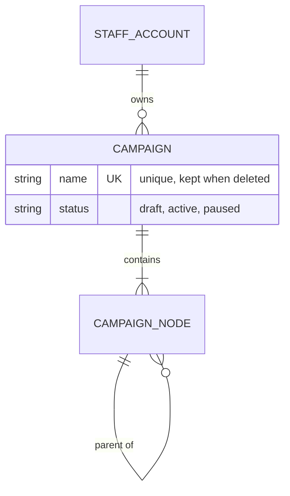
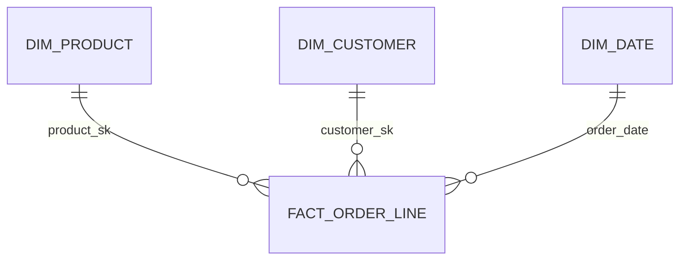
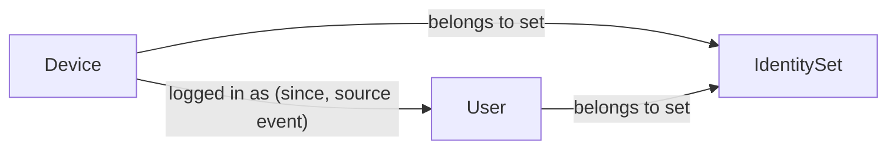

# Conceptual models

A conceptual model names the things in the domain, how they relate, and what one row of each will mean, before any table exists. Every modeling task starts here. The human approves it before any DDL is written.

## Contents

1. Pick the model kind
2. Entity-relationship model (ERD)
3. Dimensional model
4. Graph model
5. Hand-back format

## 1. Discover with questions, then pick the model kind

Questions do two jobs: they reveal the entities and relationships, and they decide the model kind. A thin question list gives a thin model, so spend most of the effort here.

1. **Collect the questions from every source**, as the people who ask them would say them:
   - every stakeholder: the business, its end users, staff who configure things, support, operators, finance, compliance, and the jobs and services that read the data;
   - every contract, requirement, use case, and decision record that touches the domain, citing the requirement id each question comes from;
   - every lifecycle: how each thing is created, changed, versioned, deleted, merged, expired, and audited.

   Expect dozens for a real domain, not a handful. For a large domain, split it into slices (for example identity, definitions, runtime, business and platform) and collect each slice in parallel.
2. **Break each question into its parts.** The nouns it names are candidate entities. The verbs that link them are candidate relationships. The words "when", "since", "which version", "who changed", and "why" are properties on a relationship, or an entity of their own when they carry more than one value. Look for the kinds that are easy to miss:
   - definitions and their instances (a campaign and one person's entry into it, a metric and its series);
   - parts of a definition (conditions, groups, filters, branches, actions, schedules);
   - versions of a definition, and what an instance was decided against;
   - changes recorded as their own things (a merge, a membership change, a status change);
   - the containers around everything (tenant, deployment, app, source);
   - derived things (an interest, a segment membership, a count), marked as derived.
3. **Trace every question to the model.** Keep a table from each question to the entities and relationships it needs. A question that cannot be traced shows a missing entity or relationship. An entity that no question needs is a candidate to drop.
4. **Match questions to kinds:**

   | The question needs | Kind |
   |---|---|
   | Consistent business records that people and apps create, change, and look up one at a time | ERD |
   | Measures added up over time and sliced by many attributes | Dimensional |
   | Paths, chains, neighbors, or connected groups of unknown size | Graph |

   A system usually needs more than one, one per layer. For example: a graph for identity, an ERD for campaign definitions, and a dimensional model for reporting on how people move through campaigns.
5. **Ask the human** what they already know or prefer: an existing model, a store they must use, a question that matters most, and entities they expect that the list lacks.
6. **Recommend** one kind per layer, with the questions each one serves and the questions it serves badly.
7. **Stop.** The human picks. Record the choice and their words in the hand-back.

## 2. Entity-relationship model

For operational systems: the records people and apps create, change, and look up.

- **Entities**: the things the business names and tracks one by one (campaign, staff account, catalog event). Each has a definition one sentence long and an identifier: the natural key that tells two of them apart in the real world. The surrogate UUID comes later, in the physical model.
- **Attributes**: facts about one entity. An attribute that has several values per entity, or facts of its own, is an entity.
- **Relationships**: a verb ("a campaign *contains* nodes", its steps), a cardinality on each side (one or many), and an optionality (zero allowed or not). A many-to-many relationship becomes an associative entity, which usually has attributes of its own (a membership has a start date).
- **Normalize to third normal form by default.** Every non-key attribute depends on the key, the whole key, and nothing but the key. Denormalize only for a measured read cost, or so that one row carries everything a CDC consumer needs, and write down which one.
- **Lifecycle**: mark each entity that people delete (soft delete) or that changes over time in a way someone must see later (history).

## 3. Dimensional model

For analytics: measures added up over time and sliced by attributes.

1. **Business process**: the event being measured (an order placed, a person completing a campaign step, a notification sent). One process, one fact table.
2. **Grain**: one sentence, "one row is one ___". Declare it before any column. Choose the finest grain the source has; coarser tables are rollups.
3. **Dimensions**: the who, what, where, and when that describe the event at that grain. A dimension that two processes share is conformed: the same keys and attributes in both, so their facts can be compared.
4. **Facts**: numeric measures true at that grain, additive where possible.

Fact table types:

| Type | One row is | Example |
|---|---|---|
| Transaction | one event | one order line |
| Periodic snapshot | one entity per period | one account per day |
| Accumulating snapshot | one process instance, updated as it moves through fixed steps | one person's entry into a campaign, with the time it reached each step |

- With more than one business process, draw a bus matrix: processes as rows, conformed dimensions as columns, a mark where a process uses a dimension.
- Mark each dimension whose history matters: it becomes type 2 (new row and surrogate key per change). See [dimensional.md](dimensional.md).
- **Shape depends on the store.** In ClickHouse, dimensions are star (flat, hierarchies as columns) and served as dictionaries. In Postgres, a snowflake (a hierarchy in its own tables) is allowed.

## 4. Graph model

For relationships: who is linked to whom, through what, and how far.

- **The concept is always nodes and edges**, whatever the store.
- **Node types**: each with a definition and an identifier, like an entity. Include the type in the identity when ids of different types can collide (a device id and a user id).
- **Edge types**: a verb, a direction, the node types on each end, and properties: when the edge started and ended, the source or evidence that created it, and a weight if one exists. An edge that can be wrong (two identities linked by a shared login) records why it exists, so it can be undone.
- **Rules**: which edges are allowed (at most one user per identity set), and what happens when a new edge breaks a rule (refuse, or keep both sets apart).
- **Questions**: for each question, the traversal it needs: one hop, a path of bounded length, a path of unknown length, or a connected component.
- **History**: whether merges and splits must be replayable. If they must, record them as events, not only the current state.

Physical mapping, chosen in the physical step:

| The questions need | Physical form |
|---|---|
| One or two hops | node and edge tables in the relational store |
| Connected components (identity sets) | a membership table: each node with the id of its component's root, maintained with union-find, plus an edge or merge log for history |
| Interactive multi-hop paths of unknown depth | a graph database, only when the relational forms are measured to fail |

## 5. Hand-back

For each model, a Mermaid diagram that renders on GitHub, then a glossary.

ERD and dimensional models use `erDiagram` with crow's-foot cardinality:

A dimensional model puts the fact in the middle, with one relationship per dimension:

A graph model uses `flowchart` with node types as nodes and edge types as labeled arrows:

Glossary, one row per entity, fact, dimension, node type, or edge type:

| Term | Kind | Definition | Identifier | Grain or cardinality | Notes |
|---|---|---|---|---|---|
| Order line | fact | One product on one order | (order_id, line_number) | one row per order line | measures: quantity, amount |

Then the traceability table, one row per question:

| Question | Source | Entities and relationships it needs | Kind that serves it |
|---|---|---|---|
| Which devices belong to this person? | R-3 | Identifier, Person, member of | graph |

End with the questions the model does not answer, the entities no question needed, and the open decisions for the human.
