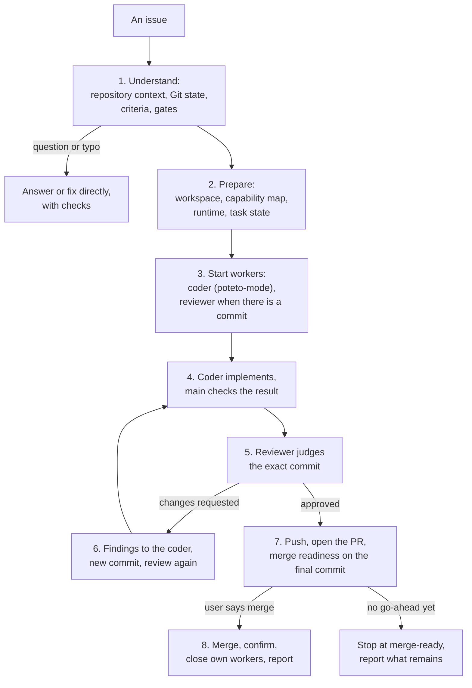

# engineering-lead

The main session for an engineering issue. It takes an issue from intake to merge: it understands the task, starts a coder to implement it and an independent reviewer to check it, routes the findings back until the review is clean, establishes that the change is ready to merge, merges only when you authorize it, and closes the workers it started. It keeps the task's state, so you can ask how it is going at any point, and a new session can pick the task up.

The repository defines the environment: its instructions, agents, skills, tools, and gates come first. [pstack](https://github.com/cursor/plugins/tree/main/pstack) supplies the coder's default way of working (`poteto-mode`, or its principles), and [superpowers](https://github.com/obra/superpowers) supplies engineering methods such as brainstorming, planning, test-first, debugging, and review. Workers run as persistent [Herdr](https://github.com/ogulcancelik/herdr) sessions when the repository allows it, or as the harness's native subagents.

## When to use it

Use it for an issue or task that changes code: a bug fix, a feature, a refactor, a migration, or review feedback on an existing change. Typical requests: "take issue #123 to merge", "fix this bug properly", "address the review on this PR". A question gets a direct answer, and a typo-sized fix is done directly; the coder and reviewer are for real engineering work.

Integration is optional: when you ask ("apply engineering-lead to this repo"), or when a task shows the repository lacks something the main session needs and you agree, it brings the engineering lead into the repository. It audits each repository, designs the integration (the capability map, the runtime, what merge-ready means there), waits for you at the decisions that matter, integrates, evaluates with real scenarios in each runtime, and reports each repository separately.

pstack, Superpowers, and Herdr are optional. Most pstack skills cannot be called as tools: the main session reads and follows them, or tells a worker to, and starts `poteto-mode` in the coder's own Herdr session. When something the task needs is missing, it says what to install instead of working from memory.

## How it works

Integration is an optional step the main session calls when asked, with its own lifecycle: audit, design, implement, verify, evaluate end to end, hand back.

## What it believes

- The main session owns the issue: the decisions, the state, the review loop, merge readiness, and delivery. The coder and the reviewer do bounded assignments; a coder working through `poteto-mode` or a Superpowers method does so inside its assignment, never as a second owner.
- The repository defines the environment. Its instructions are policy; the main session decides how that policy applies to this task. A repository capability is not replaced just because pstack or Superpowers has a similar one.
- Superpowers and pstack are methods, used as written with their gates kept, not rewritten here and not all run every time. When `writing-plans` asks who should execute the plan, the answer is the coder.
- In Herdr, one coder and one reviewer per task hand each round to each other directly, and the reviewer labels its verdict on the PR; the main session starts the pair, watches, steps in after two failed rounds, and checks the approved commit. With native subagents it relays each round.
- A worker's "done" is a claim. The main session reads the diff and the evidence. A reviewer's verdict holds only for the commit it names, and any later change needs a new review. After two failed rounds on the same thing, the approach changes before anything is sent again.
- Merge-ready is checked on the final commit: criteria, checks, CI, the reviewer's approval of that commit, the repository's approvals, no blocker. Merge-ready is not merged, and a reviewer's approval is not authorization.
- Pushing the task branch and opening its PR are part of the job and need no extra permission. Merging, approving, and deploying need the user's go-ahead. Nothing is tried just to see whether it is allowed. Credentials come from the environment, are never searched for or extracted, and workers resolve their own.
- The main session owns only the workers it started, by the identity it recorded. It never touches other sessions, even ones called `coder` or `reviewer`, and it never answers a trust or permission prompt for the user.
- The task state is the main session's alone. Workers write their own result files. Status questions are answered from the state without restarting, and a new session resumes after checking the state against reality.
- Results and delivery are reported separately, step by step: implemented, verified, pushed, PR opened, reviewed, approved, merged, deployed.
- Lessons are logged as they happen, each with the place its fix belongs and whether it landed; a lesson that repeats after a text-only fix gets a script or a check. The `retrospective` skill routes the open ones. Retrospectives may propose changes to skills or instructions; nothing shared changes without approval.

## Files

| File | What it holds |
|---|---|
| [SKILL.md](SKILL.md) | The principles, the eight-step workflow with the guide for each step, status questions, external actions, and the final report. Start here. |
| [references/project-context-discovery.md](references/project-context-discovery.md) | Learning the repository the first time and refreshing it later, the Git state on every run, classifying the request, telling rules from workflows, checking a doc is still in force, and the sensitive-data boundary. |
| [references/repository-adaptation.md](references/repository-adaptation.md) | The inventory, repository policy versus the decision for this task, the invocation modes, selecting capabilities, Superpowers and pstack as methods, capabilities for external actions, unavailable capabilities, and the capability map. |
| [references/runtime-adapters.md](references/runtime-adapters.md) | The logical worker interface, choosing Herdr or native subagents, the Herdr commands as checked, result files, blocked versus failed, waiting without blocking status questions, ownership, and cleanup. |
| [references/worker-contract.md](references/worker-contract.md) | The coder and reviewer roles, when to use them, the briefs and results, checking results, the SHA-bound review loop, and merge readiness. |
| [references/execution-lifecycle.md](references/execution-lifecycle.md) | The task state and where it may live, decisions, status questions, resuming, the final report, delivery states, and the retrospective. |
| [references/conflict-resolution.md](references/conflict-resolution.md) | The instruction types, precedence and applicability, unresolved and safety-critical conflicts, the one issue owner, side-effect and delivery boundaries, and where Superpowers and pstack differ. |
| [references/authentication-and-permissions.md](references/authentication-and-permissions.md) | The four conditions for an external action, local and remote identities, Git transport versus provider API, read-only checks, the preflight, delegated workers, failures, and what to record. |
| [references/integration-playbook.md](references/integration-playbook.md) | Optional integration: audit, design, implement, verify, evaluate with UC1 to UC5 per runtime and A1 to A12, hand back. |
| [references/integration-contract.md](references/integration-contract.md) | Optional integration: ownership, modification boundaries, completion criteria, scenario statuses, the delivery boundary, and the hand-back. |
| [scripts/watch.py](scripts/watch.py) | The background watcher the main session starts after every hand-off: it waits for the PR's head to change or a new review on it (through the repository's PR tool), or for a worker's result file, and reports blocked or stalled workers. |
| [scripts/workers.py](scripts/workers.py) | Starts, briefs, and lists the main session's Herdr workers with no shell in between: refuses the home folder, a non-repository, and starting past the machine's cap, reads each brief from a file, and confirms a slash prompt was submitted. |
| [scripts/test_scripts.py](scripts/test_scripts.py) | Tests for both scripts: `python -m unittest discover -s skills/engineering-lead/scripts -p "test_*.py"`. |
| [references/sources.md](references/sources.md) | Credits for superpowers, pstack, and rea. |

## Tests

The cases in `evals/` run in an isolated harness that loads only this skill, so they test the main session with native subagents, without the repository's own skills, pstack, or Herdr. They have not been run with `claude plugin eval` yet. The repository-level scenarios (UC1 to UC5 per runtime, A1 to A12) are in [references/integration-playbook.md](references/integration-playbook.md#phase-5-evaluate-end-to-end).

| Case | Project context | What it checks |
|---|---|---|
| `bugfix-coder-reviewer` | A small orders pipeline whose load appends, so a retried load doubles a day | Understands first; briefs a coder subagent with a local-commit boundary; checks the result itself; a separate reviewer judges the named commit; the fix is at the load; pushes and opens a PR when a remote exists (none here), never merges |
| `existing-fix-continue` | The fix already committed on a task branch, with an unreachable remote | Continues the existing work without asking, gets it reviewed, then tries the default push and PR; reports blocked on the unreachable remote without workarounds, and does not merge |
| `question-answered-directly` | The same pipeline | A question is answered from the code, with no workers, branch, worktree, state file, or edits |
