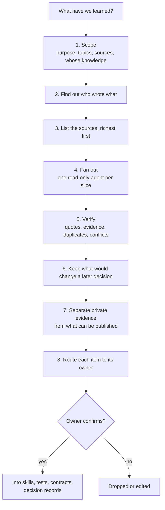

# knowledge-harvest

Collects the knowledge buried in past work (decision records, contracts, runbooks, incident notes, commit history, reviews, decision logs, and agent sessions) into a reviewed catalog. Each item in it carries its evidence, says whose knowledge it is, and names where it should live.

## When to use it

Use it before you write or update a skill from experience, when you onboard to a codebase's history, or before a retrospective over a long period. Typical requests: "what have we learned", "collect what we know about X", "mine my repos", "turn my history into rules".

## How it works

## What it believes

- Find out who wrote what before reading the content. A teammate's rule or a vendored file must not be credited to the owner.
- Every item has evidence, a file and line or a commit with a short quote, and is labeled STATED, INFERRED, TEAM, or THIRD-PARTY.
- Reversals are the richest finds. A decision that was later superseded shows what was learned, and what triggered it.
- Keep an item only if it would change a later decision. Note what was dropped, so the owner sees it was considered.
- The catalog with its evidence stays private. Anything published is written in general terms, and a secret is never copied, only reported.
- The owner confirms items before any of them go into a skill or a shared file.

## How it connects

| Skill | Relationship |
|---|---|
| [retrospective](../retrospective/README.md) | Uses this skill to gather facts over a long period, and owns the routing table for where each lesson goes. |
| Any skill | Confirmed items become its rules. This is how the other skills in this repo were written. |

## Files

| File | What it holds |
|---|---|
| [SKILL.md](SKILL.md) | The eight steps and the hand-back. Start here. |
| [references/sources.md](references/sources.md) | Where knowledge hides, and how to read each kind of source. |
| [references/item-schema.md](references/item-schema.md) | The shape of every catalog item, with an example. |
| [references/slice-brief.md](references/slice-brief.md) | The brief for each read-only subagent. |
| [evals/](evals/) | The test cases. |

## Tests

This case has not been run yet, so the skill is at version 0.1.

| Case | What it checks |
|---|---|
| `mixed-authorship-repo` | Labels a teammate's runbook and a vendored skill, captures a reversal and a failure story with evidence, and flags a token without copying it. |
