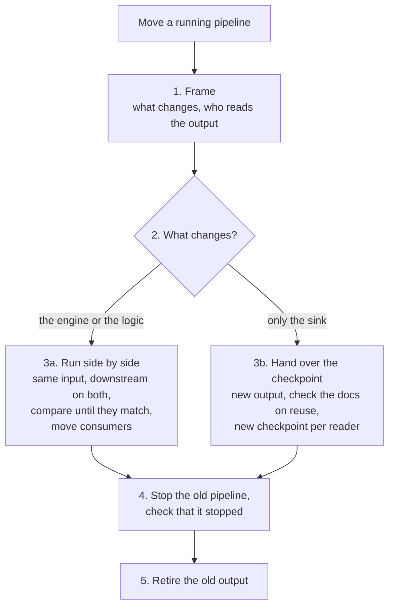

# pipeline-migration

Moves a running pipeline to a new engine version, framework, sink, or table layout while its downstream consumers keep working, then stops the old pipeline. A data migration moves stored data. A pipeline migration moves the flow.

## When to use it

Use it when you upgrade the database or engine a pipeline runs on, replace a badly laid out output table, change a stream job's sink, or rewrite a pipeline. Typical requests: "upgrade ClickHouse", "move the job to the new table", "repartition this streaming table", "switch the consumers over".

## How it works

## What it believes

- List every downstream consumer and how it tracks its position before changing anything. A consumer you missed keeps reading the old output.
- When the engine or the logic changes, run the old and new pipelines side by side on the same input, with downstream running on both sides, and switch only when the outputs match.
- When only the sink changes, check the official docs for your exact versions that the writer's checkpoint survives the change, and keep it, so the job continues from the same source position.
- Downstream streaming readers get new checkpoints on the new output, with start positions that skip nothing and repeat nothing.
- Stop the old pipeline and check that it stopped. Only one writer may remain.

## How it connects

| Skill | Relationship |
|---|---|
| [architecture-review](../architecture-review/README.md) | Decides whether to change the engine, the sink, or the layout. |
| [data-migration](../data-migration/README.md) | Moves stored history, and owns the row and column reconciliation rules. |
| [pipeline-review](../pipeline-review/README.md) | Checks the new pipeline before it runs. |
| [retrospective](../retrospective/README.md) | Looks back once the old pipeline is gone. |

## Files

| File | What it holds |
|---|---|
| [SKILL.md](SKILL.md) | The steps, both patterns, and the hand-back. Start here. |
| [evals/](evals/) | The test cases. |

## Tests

These cases have not been run yet, so the skill is at version 0.1.

| Case | What it checks |
|---|---|
| `engine-upgrade-side-by-side` | An engine upgrade with downstream consumers runs old and new side by side, compares what consumers read, then stops the old pipeline. |
| `delta-table-new-layout` | Replaces a badly partitioned streaming table, handing over the writer's checkpoint and giving downstream readers new ones. |
