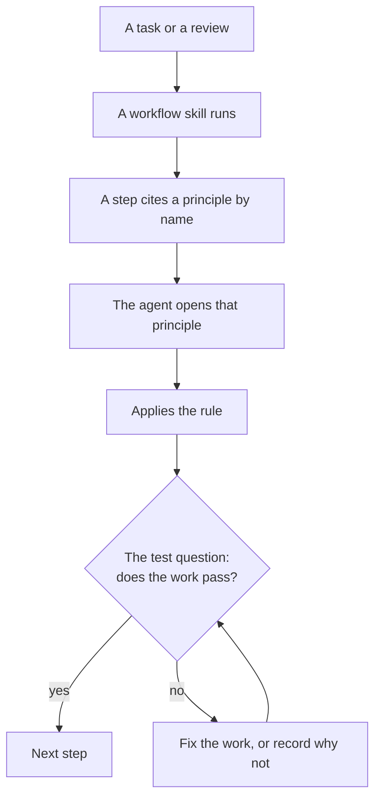

# principles

Each folder here holds one principle: a single rule that more than one skill relies on. Workflow skills cite a principle by name instead of repeating it, so each rule is written once.

## How a principle works

An agent can also load a principle on its own when the task matches its description, without any workflow.

## What a principle holds

- **The rule**, in one or two sentences.
- **Why**: the failure the rule prevents.
- **The test**: questions a reviewer can answer from the work.
- **An example**, with numbers marked as illustrative when they are.
- **Read**: links to outside documentation, when the rule rests on it.

## When a rule becomes a principle

`principle-extract-shared-rules` decides it: two or more skills need the rule, it makes sense on its own, and it does not depend on one workflow's order or tools. A rule used by one step of one workflow stays in that workflow.

## Tests

Principles have no evals of their own. The eval cases of the workflow skills that cite them check whether the rule changes behavior.
