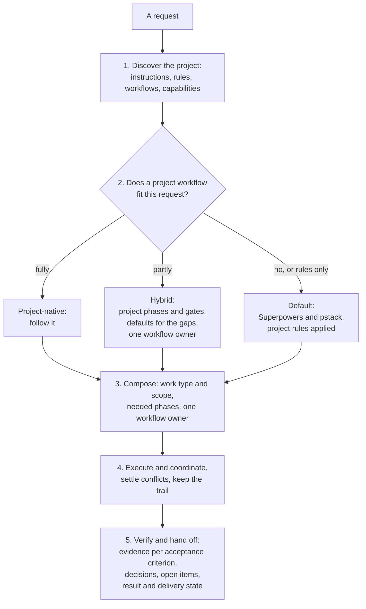

# project-manager

An engineering workflow router. It takes software or data work from request to verified delivery. It first learns how the project works, then picks a workflow. When the project has a workflow for this work type, it follows that. When the project has none, it composes a default from [superpowers](https://github.com/obra/superpowers) for method and [pstack](https://github.com/cursor/plugins/tree/main/pstack) for investigation, execution, and orchestration.

## When to use it

Use it when you start a feature, a bug fix, a refactor, a migration, an investigation, or any multi-step change. Typical requests: "take this from start to finish", "plan and build this", "fix this bug properly".

Use **integration mode** to bring the project manager into one or more repositories: "apply project-manager to this repo", "integrate the project manager into these two projects". It audits each repository, plans the integration per repository, waits for you at the decisions that matter, integrates, evaluates with real scenarios, and reports each repository separately. A short prompt is enough:

```text
Use project-manager in integration mode on /path/to/repo-a and /path/to/repo-b.
Repo A has mature workflows: prefer them. Repo B has gaps: fill them with the defaults.
```

Superpowers and pstack are needed only for the phases the project does not cover. If the run needs one that is not installed, it tells you what to install instead of working from memory.

## How it works



Integration mode has its own lifecycle: audit, design, implement, verify, evaluate end to end, hand back. It does not run the normal lifecycle to orchestrate itself.

## What it believes

- The project's established workflow comes first, when it applies to the request and is still in force. Superpowers and pstack fill gaps; they do not replace a process the team already uses. An out-of-date or superseded doc is not a workflow just because it is in the repo.
- Working rules are not a workflow. A project with only rules still needs a process, and that process must obey the rules.
- A workflow fits when it answers five questions for this request: where to start, which phases, what moves work between them, who does each, and how done is confirmed.
- Hybrid needs an applicable part of a project workflow. Rules alone mean default with the rules applied, and a workflow for another work type counts only for what it says applies to all changes. A doubtful workflow contributes only its confirmed parts.
- Use only what the request needs. Discovery reads the smallest relevant context, a read-only question needs no branch, and a bug fix rarely needs brainstorming.
- A provider whose contract does not fit the request is swapped for another capability; that is a choice of tool, not a conflict.
- Results and delivery are reported separately. Done means the acceptance criteria are met with evidence checked criterion by criterion; implemented, verified, PR opened, approved, merged, and deployed are distinct states, each marked complete, not reached, not requested, or not applicable.
- One workflow owner per work package, chosen before anything else is composed. The workflow owner decides the phases and gates and designates one execution orchestrator; capability providers supply methods and specialized capabilities; human approvers meet the approval gates. Superpowers and pstack each have an end-to-end workflow, so a run takes one of them as workflow owner instead of splicing their steps.
- Provider contracts are kept. A skill's gates and required order, such as design approval before building, are not skipped by composing pieces of it.
- Working rules, workflows, approval gates, methods, and capabilities are different things. Having a skill for a phase does not mean the project's rules for it were met, and the user's go-ahead does not meet an approval gate that names someone else.
- Conflicts are settled by precedence when it gives a clear answer, and the ruling is recorded. Only a conflict that is unclear or consequential goes to the user. A mandatory rule is never dropped silently.
- Integration is done when the contract's criteria are met with evidence from real scenarios, not when files are copied. The project manager's own files stay the same in every repository; what is specific to a repository goes in that repository's instructions.
- Each skill is used as written, by invoking it or opening its file. When one is missing, the run first checks whether it is needed and whether something installed covers it, and asks for an install only when nothing does. A missing skill is never rebuilt from memory.

## Files

| File | What it holds |
|---|---|
| [SKILL.md](SKILL.md) | The principles, the five stages with the guide for each, and the hand-back. Start here. |
| [references/project-context-discovery.md](references/project-context-discovery.md) | A first classification of the request, what to look for, telling rules from a workflow, checking a workflow is still in force, finding capabilities with their role and contract, and the context note. |
| [references/workflow-resolution.md](references/workflow-resolution.md) | The five questions, the three modes, the decision table, uncertain workflows, one execution path in hybrid mode, and what to do when the request changes. |
| [references/default-workflow.md](references/default-workflow.md) | Work types and scopes, the phases each needs, which Superpowers or pstack capability supplies each activity, choosing the workflow owner, and how this skill and pstack `poteto-mode` split the routing. |
| [references/capability-mapping.md](references/capability-mapping.md) | The single definition of the four roles; where each phase's action, responsible role, and capability come from; checking scope, contract, availability, and compatibility; the phase map; native invocation versus manual read-and-follow; and what to do when a capability is unavailable. |
| [references/conflict-resolution.md](references/conflict-resolution.md) | The five instruction types; precedence and applicability; resolvable, unresolved, and safety-critical conflicts; one execution orchestrator per work package; where Superpowers and pstack differ. |
| [references/handoff-contract.md](references/handoff-contract.md) | The decision trail, the hand-back fields, verification per acceptance criterion, result versus delivery state, and sizing. |
| [references/integration-playbook.md](references/integration-playbook.md) | Integration mode: audit, design, implement, verify, evaluate end to end, hand back, and when to use sub-agents. |
| [references/integration-contract.md](references/integration-contract.md) | Integration mode: ownership, modification boundaries, completion criteria, scenario statuses, the delivery boundary, and the hand-back. |
| [references/sources.md](references/sources.md) | Credits for superpowers, pstack, and rea. |
| [evals/](evals/) | The test cases. |

## Tests

These cases have not been run yet, so the skill is at version 0.3.

| Case | Project context | What it checks |
|---|---|---|
| `project-native-refactor` | A full change workflow in CONTRIBUTING.md | Follows the project's workflow for a refactor, and does not run a parallel default process |
| `refund-request` | Rules only in AGENTS.md | Default workflow with the rules applied: asks the question only the user can answer, presents a short design, and stops before code |
| `retry-doubles-totals` | Rules only in AGENTS.md | Default bug-fix workflow: reproduces, finds the cause from logs, failing test first, fixes the load, pastes evidence |
| `hybrid-migration` | Gates for all changes, no migration process | Hybrid: keeps the project's test, branch, and review gates, plans the migration from the default, follows the backward-compatibility rule, and does not treat the user's request as the code-owner review |
| `bare-repo-investigation` | Only code and a README | Default, read-only: answers with sources, no branch, worktree, or test loop |
| `conflict-no-worktrees` | A project rule against worktrees | Follows the project rule over the default's worktree step and records the conflict |
| `missing-frameworks` | Rules only, run with neither framework installed | Reports what is missing and how to install it, and does not claim to follow skills it does not have |
| `integration-audit-first` | Rules, a feature workflow, and a custom skill; integration mode | Audits before changing anything, plans per work type, keeps the project's rules and skill intact, and reports scenario status honestly |
