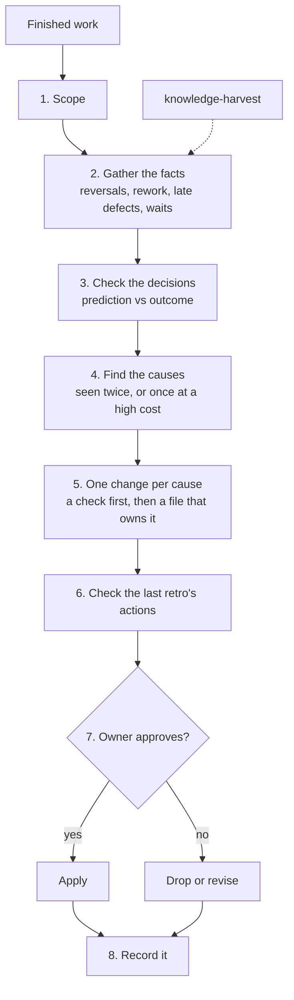

# retrospective

Looks back at finished work (a session, a pull request, a round of fixes, an incident, or a design decision that has been running for a while) and turns each lesson into one change in the file that owns it.

## When to use it

Use it after shipping, after an incident, at the end of a round of work, or when a decision's revisit condition fires. Typical requests: "retro", "what did we learn", "look back on this", "why do we keep hitting this". Use it also to write up a lesson or explain an incident to people who were not there.

## How it works

## What it believes

- A retrospective that changes nothing did not happen.
- Facts, not impressions: reversals, rework, defects caught late, and waits, each with a commit, comment, or log line.
- Ask why until you reach the process: a brief, a contract, a skill, a check, a missing number, or a shared premise.
- A one-off is not a lesson. Keep a lesson that happened twice, or once at a high cost.
- Prefer structure over text. If a test, a lint, or a template default can stop the mistake, change that and add no sentence.
- A lesson that came back after a text-only fix proves the text failed. Count the earlier occurrences from the log, then replace the rule with a script or a check.
- Generic skills stay generic. A lesson the next project would hit goes into the generic skill; this project's names, paths, and sizes stay in the project, and one person's machine facts go to memory.
- A "Changed:" line in a lesson log is a claim. It counts as done only when the change is in the file.
- Each lesson goes to the one place that owns it, and shared files change only with the owner's approval, in their own pull request.
- Check whether the last retrospective's actions helped, then keep, adjust, or revert them.
- A lesson written to teach starts with how the system works, not with the symptom: the mechanism, the normal flow, the root cause, the fix, the result with numbers, and a generic takeaway.

## How it connects

| Skill | Relationship |
|---|---|
| [knowledge-harvest](../knowledge-harvest/README.md) | Gathers the facts when the period is long or spans many repositories. |
| [architecture-review](../architecture-review/README.md) | Takes a decision the retrospective shows was wrong, or whose revisit condition fired. |
| [pipeline-review](../pipeline-review/README.md) | Checks pipelines against the rules a retrospective adds. |

## Files

| File | What it holds |
|---|---|
| [SKILL.md](SKILL.md) | The eight steps, the routing table, and the hand-back. Start here. |
| [references/sources.md](references/sources.md) | Where the facts are, with commands, and the questions to ask the people involved. |
| [references/retro-template.md](references/retro-template.md) | The retrospective file template. |
| [references/lesson-writeup.md](references/lesson-writeup.md) | How to write one lesson to teach: the six parts in order, a template, and a worked example. |
| [evals/](evals/) | The test cases. |

## Tests

The cases run with `claude plugin eval`, which needs a shell sandbox; on a machine without one, run each case's prompt with subagents, once with the skill and once without, and grade with its graders.

| Case | What it checks |
|---|---|
| `incident-lesson` | From symptom-first incident notes: writes a lesson that explains the replication slot and the WAL cap before the error, keeps the six parts in order, quotes the exact error, says why the alert missed it, gives the downtime, the no-loss evidence, and the measured peak without inventing numbers, and ends with a generic takeaway. |
| `lesson-log` | From a lead's lesson log: turns a lesson that text failed to fix three times into a script or check, groups recurring harness blocks, catches a false "Changed:" claim, puts generic lead lessons into the generic skill without project facts, sends machine facts to memory, and drops one-offs. |
| `repeated-fixes` | Finds one shared cause behind three fixes in git history, notes a test that checks nothing, and proposes a structural change. |
| `round-with-decision-log` | Turns two repeated review findings into structural changes, drops a one-off, and judges the last retro's actions. |

`repeated-fixes` did not separate the skill from a baseline agent in a first run (both found the cause and proposed the test); `lesson-log` is modelled on a real lesson log where the skill did separate.
