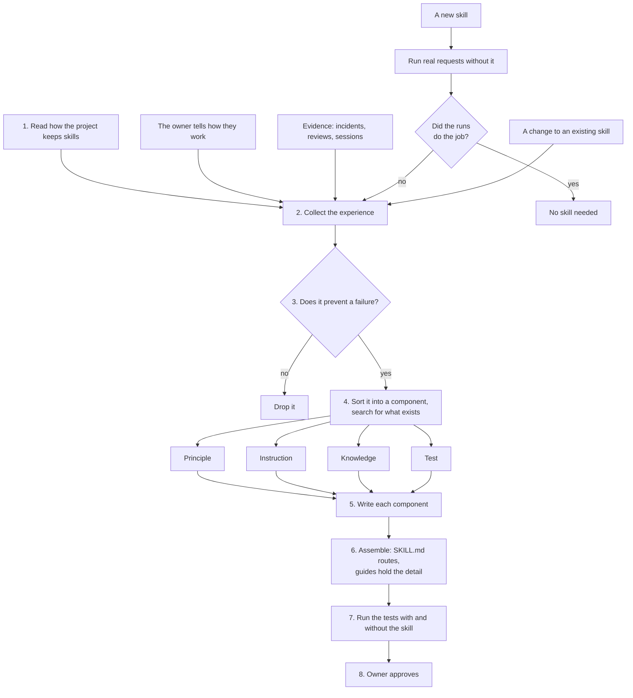

# skill-authoring

Teaches an agent to turn the owner's experience, and evidence from real work, into skills built from five components: principles, instructions, knowledge, tests, and skills. The skills it writes, and this skill itself, work in any project.

## When to use it

Use it when you create a skill, turn your experience, lessons, review comments, or incident notes into skills, add to, split, merge, or retire a skill, or review a skill draft. Typical requests: "write a skill for this", "package what I know", "make this a skill".

## How it works

The owner's experience and the evidence become lessons, every lesson becomes a rule, every rule goes into one component, and the components are packaged into a skill. A change to an existing skill takes the same path, and is tested against the old version instead of against no skill.

## What it covers

| Component | What it is | Lives in | Create one when |
|---|---|---|---|
| Principle | One rule that holds across tasks or steps, with its Why and its test questions | `principle-<rule>/SKILL.md` when shared; the skill's `## Principles` section when only one skill needs it | Two or more skills need the rule, it applies on its own, or it holds for every step of one skill |
| Instruction | One step of a task: what to do, the exact command, the principles it applies | The steps of a skill's `SKILL.md` | The order matters, or a real run skipped or botched a step |
| Knowledge | Facts a step needs and the agent cannot work out: numbers, schemas, templates, examples, links | `references/<topic>.md` in the skill | A step needs more than a few lines of detail, or a run guessed a fact wrong |
| Test | A test case that runs the agent on a real request, or a code test in the project | `evals/<case>/` in the skill, or the project's tests | The skill should change a behavior, or a machine can check the rule |
| Skill | One recurring task: a main file that routes, with its guides and test cases | `<skill-name>/SKILL.md` | A recurring task needs two or more steps that belong together |

Almost everything fits one of these five, and the skill depends on no particular repo, tool, or other skill. Its own five principles hold for every step: every sentence changes what the agent does, start from experience, explain the reason and leave room for judgment, keep it generic, and the main file routes. It follows the project's own layout for skills, and the paths above are the default for a project that has none.

## What it believes

- Every sentence should change what an agent does. One that would not gets deleted.
- Rules come from experience. The owner's experience, told to the agent, counts even if it happened once. Evidence from real work counts when it repeats, or cost a lot once. A new skill also learns from runs of real requests without it.
- The agent shapes experience into components and invents no rules. Anything it infers is labeled inferred until the owner confirms it.
- Skills are generic. Project names, paths, tools, and versions are inputs or examples, and a skill links another skill only when the task cannot be finished without it.
- The main file routes. `SKILL.md` holds the principles, a routing table, short steps, and the hand-back, and sends the agent to one guide per component, topic, or situation for the detail.
- Every rule names the failure it prevents and a question that catches a breach.
- Each rule lives in one place. Instructions cite principles by name and never restate them, and third-party documents are linked, not copied.
- A skill briefs a capable colleague rather than scripting a machine. Each rule carries its reason, so the agent can handle cases the author did not foresee. "Always" and "never" are kept for hard limits, and the steps are the usual order, not a script.
- Instructions are written for an agent that reads them cold: the purpose of each step, exact commands and examples with numbers where they matter, and a hand-back the owner can check.
- A rule a machine can check becomes a code test, not a sentence.
- A skill is proven by running it with and without the skill, never by reading it.
- After an incident, a review comment given twice, or a decision you would defend, ask: what failure did it prevent, what is the rule, what question catches it, and which component owns it.

## Files

| File | What it holds |
|---|---|
| [SKILL.md](SKILL.md) | The five principles, the routing table, the steps, and the hand-back. It routes to the guides below. Start here. |
| [references/principle.md](references/principle.md), [instruction.md](references/instruction.md), [knowledge.md](references/knowledge.md), [test.md](references/test.md), [skill.md](references/skill.md) | One guide per component: what it is, when to create it, how to write it, and its template. |
| [references/experience.md](references/experience.md) | Collecting experience from the owner, evidence, and runs, and turning it into rules and components. |
| [references/change.md](references/change.md) | Adding to, splitting, merging, fixing, or retiring an existing skill. |
| [references/example.md](references/example.md) | One team's lessons sorted into components and organized into a skill. |
| [references/review.md](references/review.md) | What to check on each component before testing. |
| [references/sources.md](references/sources.md) | Where the approach comes from: pstack, and the routing main file of reverse-engineer-anything. |
| [evals/](evals/) | The test cases. |

## Tests

These cases have not been run yet, so the skill is at version 0.1.

| Case | What it checks |
|---|---|
| `notes-to-skills` | From a team's notes, writes a principle with its Why and test questions for a lesson seen twice, writes a code test for a rule a machine can check, cites an existing principle instead of restating it, drops a one-off, and hands back for approval without claiming the skill was tested. |
| `owner-experience` | From an owner's account of how they review SQL changes, keeps every point including a one-time incident, keeps the skill generic, cites an existing shared principle, does not link an unrelated skill, marks its own additions as inferred, and writes rules with their reasons instead of bare commands. |
| `new-skill-from-baseline` | For a new skill with no notes, writes real requests first, runs them without the skill, turns only the gaps those runs showed into components, and keeps the new skill's main file to routing and short steps. |
