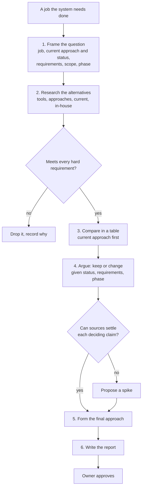

# tech-market-research

Researches the tools and approaches that could do one job in a system, compares them with the current approach, argues whether to keep or change it, and writes a report that ends in a final approach. Every fact that could decide it has a primary source, a version, and a date.

## When to use it

Use it before choosing or replacing a tool or an approach. Typical questions: "what should we use for X", "should we switch from Y", "is Y still maintained", "how much would Z cost", "what are the alternatives to W".

## How it works

## What it believes

- The answer is what fits this system now. Every argument is judged against the current status, the requirements, the scope, and the phase.
- The current approach is the first row of the comparison, and a small in-house build is an option until a requirement rules it out.
- Metrics are chosen from the requirements before the table is filled (`principle-analyze-trade-offs`).
- Established products show the shape that works (`principle-follow-the-common-shape`).
- Facts come from primary sources: vendor docs for the version you would run, dated pricing pages, release notes, issue trackers, and source code. A benchmark site is a lead, not a source.
- Every deciding fact says how it is known, and one that cannot be verified is marked Unverified (`principle-label-the-evidence`).
- The gotchas a vendor's page leaves out are looked for on purpose.
- The report ends in a final approach, with its cost and the conditions that would reverse it. The owner approves it.

## Files

| File | What it holds |
|---|---|
| [SKILL.md](SKILL.md) | The principles, the six steps, and the hand-back. Start here. |
| [references/checklist.md](references/checklist.md) | What to check for each option, with commands for reading a project's license and releases. |
| [references/report.md](references/report.md) | The report format. |
| [evals/](evals/) | The test cases. |

## Tests

This case has not been run yet, so the skill is at version 0.1. It needs web access.

| Case | What it checks |
|---|---|
| `cdc-postgres-to-clickhouse` | Replacing a nightly CSV copy during a pilot: a dated, sourced report with licenses, releases, and gotchas, the current job as the first row of the comparison, an argument tied to the current status and the pilot phase, labels on deciding claims, flagged unverified claims, and a final approach for the owner to approve. |
